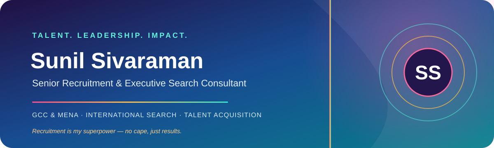
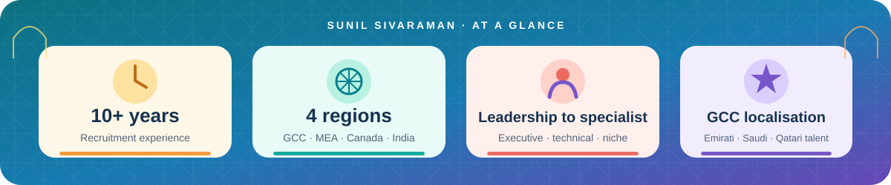
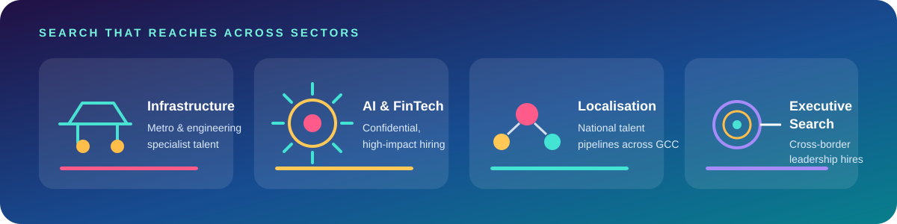
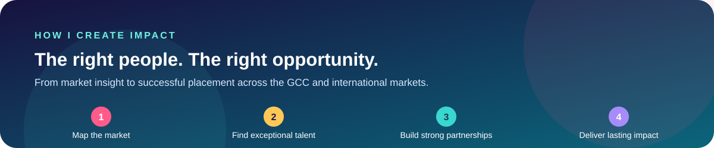
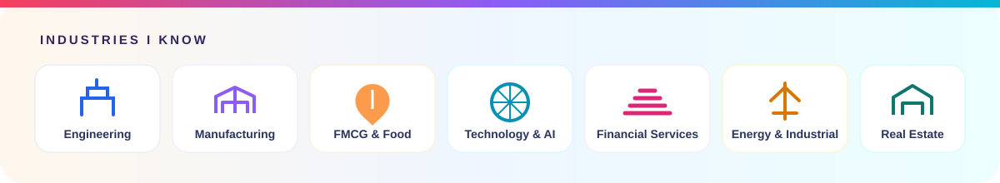
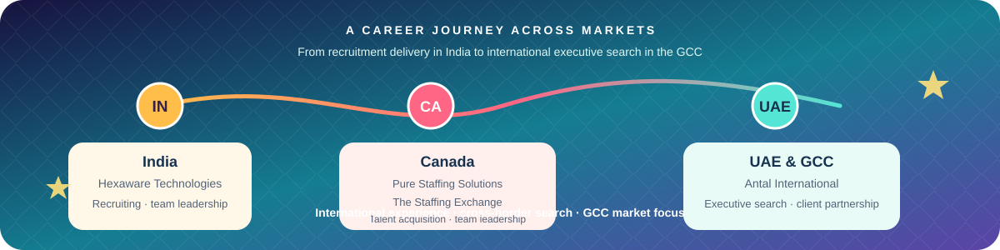

   

## Executive Search | Talent Acquisition | GCC & International Markets

Dubai-based recruitment professional with **10+ years of experience** across the GCC, Middle East & Africa, Canada and India. I partner with organisations to find leaders and specialists through executive search, targeted sourcing and hands-on recruitment delivery.

> Recruitment is my superpower — no cape, just results.

### At a glance

## Selected Project Highlights

| **Infrastructure & Metro** | **AI & Financial Technology** |
|:---|:---|
| Recruited specialised technical talent for a major metro and infrastructure programme in Saudi Arabia. | Supported hiring for a confidential AI-focused initiative within a UAE government financial institution. |

| **National Talent Pipelines** | **Cross-border Executive Search** |
|:---|:---|
| Built targeted pipelines supporting Emiratisation, Saudisation, Qatarization and wider GCC localisation mandates. | Developed multinational client relationships and coordinated searches across the UAE, KSA, India, CIS and Europe. |

*Client and candidate information is kept confidential.*

## What I do

- **Executive search:** C-level, senior leadership and specialist appointments
- **Full-cycle recruitment:** Role briefing, headhunting, assessment, negotiation and placement
- **Client partnership:** Account development, stakeholder management and business development
- **Talent intelligence:** Market mapping, competitor research and salary benchmarking
- **Recruitment leadership:** Team coaching, KPI management and delivery improvement

## Sector experience

**Engineering & PMC** · **Rail & Metro** · **Infrastructure** · **Manufacturing** · **Building Materials** · **FMCG & Food** · **Technology & AI** · **Financial Services** · **Real Estate** · **Energy & Industrial** · **Supply Chain**

## Career journey

## Recognition & results

- **Top Closer, 2022 and 2023** — The Staffing Exchange; including a **CAD 45,000 single recruitment deal**
- **Top Closer, 2020** — Pure Staffing Solutions
- Developed and converted **two multinational client accounts** at Antal
- Achieved a **96% closure rate** in background investigation delivery
- Delivered hard-to-fill technical, specialist, senior management and executive mandates

## Search toolkit

**LinkedIn Recruiter** · Boolean & X-ray search · Talent mapping · SignalHire · ZoomInfo · GulfTalent · Bayt · NaukriGulf · Indeed · Monster · Workday · Zoho Recruit · JobAdder · Excel · Google Sheets

## Education & certifications

**B.Sc. Information Technology** — SRR Engineering College · **Diploma, Computer Technology** — SMPT Polytechnic College

Certified Internet Recruiter — Naukri Gulf · LinkedIn Recruiter · Talent Sourcing · HR as a Business Partner

---

### Let's connect

For executive search, talent acquisition, or recruitment conversations:

